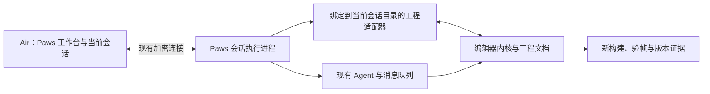

# Paws 动画工作台集成

目标是让用户在 Paws 内编辑影片、对时间点或画面区域标注，并把明确的一批标注交给当前 AI 会话回改，检查新版本后继续迭代。目标不等同于从 Paws 打开另一个 localhost 网页。

开发基线：`774649da5db89f08dbda9115eee70bc414809169`，工作分支 `motionharness-workbench`。本文件区分已实现底座与待选择、待实现部分；不是上线完成证明。

## 已核实的边界

- 当前用户设备是 MacBook Air，执行端是 Mac mini。浏览器里的 `127.0.0.1` 指向 Air，不能作为 Mac mini 工程的跨设备地址。
- Paws 已有账号、加密会话 RPC、机器连接、消息排队、文件工作区和版本能力。复用这些归属与身份边界，不另建一套 AI 聊天或任务执行队列。
- MotionHarness 0.1.8 的 Studio、Core、Project Format 等安装模块声明 GPL-3.0-only，SDK 声明 MIT。可读发布 JS、类型声明和协议不等于已获得原始 TSX/Rust 仓库或已验证独立重建。
- Paws 当前声明 MIT。编辑器代码引入、修改、分发与升级方式需要明确选择并评估适用许可，不能把进程或 iframe 隔离当作已解决许可问题。本次底座自行实现公开 CLI 的数据适配，没有复制第三方编辑器实现或新增 MotionHarness npm 依赖。
- 现有 `.vmg` 影片证明了人工标注 → Agent 修改 → 验帧 → 按 requestVersion 完成请求的路径；自动 AI 审片、自动创建标注、Paws 内嵌编辑器和跨设备素材传输尚未实现。

## 两条集成路径：等待用户选择

1. **先接完整 MotionHarness 编辑器**：Paws 管会话、工程入口和 AI 回改，保留原生编辑内核、轨道、标注和导出。最快复用已验证能力；仍须核对运行依赖、事件机制、远程资源传输及 GPL 分发义务。
2. **Paws 自有编辑器**：Paws 自己实现工作台和文档接口，按模块许可决定可复用范围，逐步接入轨道、关键帧、画布和导出。控制力更强，编辑与渲染能力的工作量明显增加。

两条路径共享下面的会话、工程和标注协议。本次只实现共同底座，用户尚未选择；没有把预选或未回复当成决定。

## 归属与传输

绑定必须同时包含 server/account/machine/session/project；`projectId` 不能单独充当访问许可。工程文档、素材、构建和导出以执行机为权威，Paws 保存会话关联、待发送意图和展示状态，不维护另一个可覆盖原文档的副本。

第一阶段只允许当前会话目录或其子目录内的工程；解析 realpath 后校验，拒绝父目录、同名前缀的兄弟目录、符号链接逃逸和指向外部的工程配置。当前 Paws 源码会话不能因此读写旁边的影片工程。应在影片目录创建/使用正确会话；未来跨根工程选择必须加入独立的机器侧授权绑定，不能扩大普通文件 RPC 范围。

完整编辑器还需要 JS/CSS/字体/素材加载、音频、帧模块、上传下载及事件通道。现有 MCP App inline HTML 资源通道不能直接视为完整 Studio 的现成宿主。后续需验证受控资源桥或编辑器传输适配器；不把原生 loopback token、任意 URL 代理或任意端口能力交给网页。

## 本次实现的 M0 接口

代码：`happy-wire/src/motionWorkbench.ts`，CLI `modules/motionWorkbench/bridge.ts`，App `sync/motionWorkbench.web.ts`。

| 加密会话 RPC | 输入 | 结果与限制 |
| --- | --- | --- |
| `motionWorkbenchInspect` | 当前会话内的 `projectPath`，默认 `.` | 调用本机公开 CLI `marker list`，要求完整快照；返回工程 ID、文档 revision、buildId、markerVersion、snapshotHash 与原有标注语义字段 |
| `motionWorkbenchPrepareReview` | 同一工程路径、显示时的 projectId/snapshotHash、选中的 marker ID/requestVersion | 重新读取工程快照，任一绑定变化即拒绝；返回经过版本核对的标注与结构化 Agent 请求，不发送消息、不完成标注 |

原生工具来自执行机 PATH 的 `mh`，或执行进程启动时设置的 `PAWS_MOTIONHARNESS_BIN`。此变量由宿主配置，不能由远端 RPC 参数设置。本次不安装工具、不改全局 PATH、不重启 daemon。原生 CLI 会读取/可能构建工程源码；“只读”表示适配器没有发出编辑/完成命令，不保证第三方进程绝无缓存写入。

每个会话适配器最多一个进行中的请求；30 秒原生超时、1 MiB 快照、1000 条标注、最多选中 100 条回改。请求不自动重试，不创建轮询或定时任务。App 在请求前后核对账号运行时，通过现有 session RPC 访问正确执行进程，不从 Air 直连 Mini 的 loopback。

工程 ID、标注请求版本和文档版本含义不同。文档/源码构建改变，即使标注 ID 不变，也必须重新检查。空的完整快照代表没有请求；不把旧缓存的标注复活。文本按 JSON 数据封装，保护代码块分隔符，不插值成 shell 命令。未来 UI 还须在组件所有者层丢弃工程/会话切换后的旧异步结果。

## 后续用户路径与 UI 约束

- 首先针对 PC Web 会话工作区，在现有文件/媒体区加入影片工程入口；聊天、工程身份和编辑工作区可同时看见，不另建独立 AI 登录。
- 编辑器显示当前时间、轨道、选中对象与标注。人工标注、AI 建议和用户已修改的 AI 建议要有来源；尚未发送、执行中、待复验、已完成与版本冲突分别显示。
- 使用当前 Paws 的 `theme.colors.surface/surfacePressed/surfaceSelected`、文字/分隔线/状态语义、Typography 与现有按钮/面板；编辑画布中的成片原色不做主题替换。
- 加载、空、工具未安装、离线和工程不匹配有可执行反馈。切换工程/会话不丢草稿，关闭不取消已提交任务，不把离线当成 0 条标注。旧请求和事件必须按绑定隔离。
- 用户选择标注 → 准备快照 → 通过现有消息排队提交一次 → Agent 检查原生快照并修改 → 构建/验帧 → 保存版本与证据 → 原生内核仅完成已核验的 requestVersion。
- 暂不新增自动审片或自动派发权限。AI 自动标注与人审确认是后续独立能力，不能把“AI 执行完”显示成“用户已认可”。
- 草稿保存、文档变化、Agent 完成和连接恢复使用事件或用户动作触发。安装版 Studio 本身存在状态轮询代码，完整嵌入时必须先审查并处理相关路径；不能声称当前第三方编辑器整体已无轮询。

## 验收范围

| Case | 通过标准 | 当前范围 |
| --- | --- | --- |
| M0-1 工程隔离 | 父目录、兄弟目录、symlink 逃逸在启动工具前拒绝 | 协议与真实文件系统单测 |
| M0-2 快照和回改 | 完整 native 快照可读，旧 build/revision/评论版本不能送回改 | 协议/适配器单测及原生 CLI 试验 |
| M0-3 请求边界 | 空快照清空请求；重复选择、超限、工具缺失有明确结果，不安装、不自动重试 | 单测 |
| M1-1 内嵌编辑 | Air 的 Paws 内真实打开 Mini 工程，拖动时间线并保存 | 未实现，等待路径选择与完整资源桥 |
| M1-2 AI 回改 | 在 Paws 标一处 → 发送一次 → Agent 改准确对象 → 新版本复验 | 未实现 UI 与消息调度接线 |
| M1-3 恢复与隔离 | 刷新/断线/切工程不覆盖草稿，不混账号或旧请求 | 未实现工作台状态层 |
| M1-4 版本与交付 | 对比/恢复新旧版本，导出同一工程并在 Air 验证 | 未实现 |

M0 没有新增可见 UI，Before 可由基线 commit 重放。M1 真实浏览器与当前设备验收必须走 Ego OPS/Ego，截图范围沿 CLAUDE.md 先问用户。没有已批准的临时外部预览，不发布分支到替代站点或正式 Web。独立评审未进行，当前没有配置可自动委派的角色。类型与单测通过不等于完整集成、发布或 Air 可用。

执行证据统一记录在 `docs/validation/motion-workbench-integration.md`，不复制到 Skills 作为另一份工程状态。
