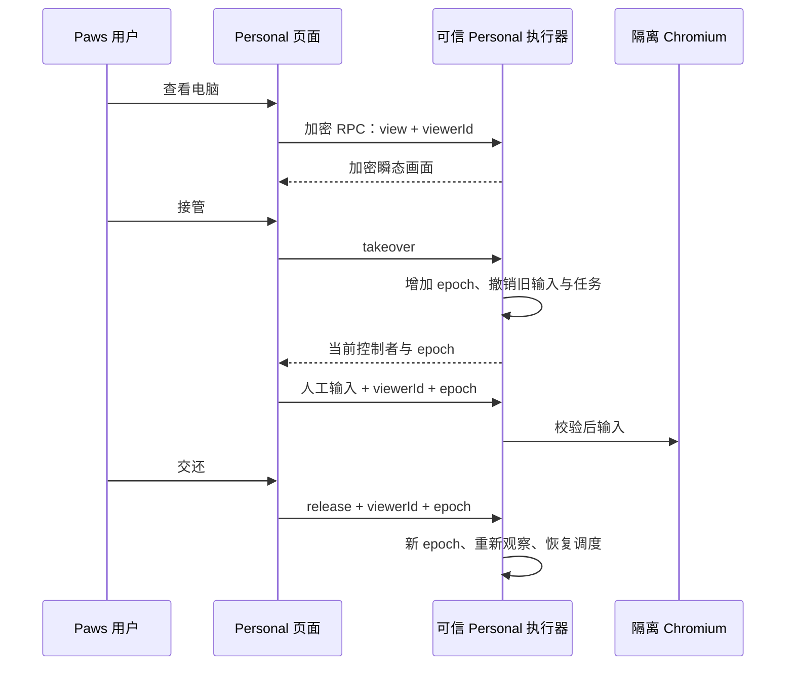

# Personal 的隔离电脑与 chrome-use

Personal 的模型循环、记忆、身份、审批和模型接口凭据运行在可信 Node 进程中。启用 Docker 后，模型的文件和命令工具只操作隔离的 `/workspace`；浏览器操作由固定版本的 chrome-use 执行。失败不会回退到宿主命令或宿主浏览器。

这是一台持久的 Linux **浏览器电脑**，支持浏览器画面、人工输入和沙箱文件/命令。它不模拟 ChromiumOS，不提供完整 Linux 桌面，也不宣称实现厂商私有的 Auto-review、凭据保险库或多租户 microVM。

## 使用与兼容

执行机需要已启动的 Docker。Personal 空白入口可选择“本地工作区”或“隔离云电脑”；已有本地对话顶部的“新建云电脑对话”会先显示设备和模式选择，确认后创建新对话，原对话保留。只有声明隔离协议能力的新版执行机可创建此模式；旧版不会接到可能静默降级的 Docker 请求。

也可选择机器配置中的 `executionTarget`：

```json
{
  "executionTarget": "docker"
}
```

此字段与现有模型配置放在同一 `~/.happy/personal-agent/config.json` 中。也可使用 `PAWS_PERSONAL_EXECUTION_TARGET=docker` 或 `paws personal --execution-target docker`。未设置时保留原来的本机模式。

```sh
# 生命周期操作不需要模型 Key，只有显式 start 会构建/创建资源
paws personal computer start
paws personal computer status
paws personal computer stop

# 创建新的隔离 Personal 会话
paws personal --execution-target docker
```

恢复原对话时使用其已保存的执行目标。没有目标字段的旧会话属于本机模式，不会因为机器配置改变而迁移。CLI 拒绝同时指定 `--resume` 和 `--execution-target`。既有 CLI worker 不会热更新。

支持隔离电脑的执行器会声明 `personalExecutionTarget=docker` 与 `personalComputer=true`。Personal 页顶部才出现“云电脑”入口；旧执行器不显示不可用按钮。宽屏并排查看，也可展开画面再返回分栏；窄屏打开独立面板。个人对话历史可切回原对话，关闭电脑面板后保留原对话与草稿。

## 浏览器工具

固定 chrome-use **v1.5.291**。镜像从其官方 GitHub Release 下载 Linux 对应架构的包，按固定 SHA-256 校验，保留许可证。不会执行在线安装脚本、写全局 Skills、安装浏览器策略或复制本机 Chrome 登录态。

模型只得到两个浏览器工具：

- `browser_snapshot`：chrome-use 的交互快照及 `@eN` 引用。
- `browser_action`：白名单中的语义点击、填表、键盘或导航，完成后返回新观察。引用来自最近快照，未知结果不自动重放。

模型不能直接提交 CDP 方法、任意页面 JavaScript、Cookie 导出命令或 Chrome 启动参数。原生 CDP 只用于固定观察、实时画面与人工输入的底层控制。chrome-use 有独立会话和资料路径，禁用后台更新检查与自动重连。

官方 Ego 目前不提供 Linux 版本或外接任意 CDP 端点的公开契约。非官方 Linux 移植版的快照和空间隔离与官方实现不同。本项目按用户明确选择使用 chrome-use 处理隔离电脑；普通宿主网页操作仍遵循 Ego 的规则。

## 查看、接管与交还



查看是只读的。接管后，Agent 的模型/工具调度通过事件等待暂停，已运行的任务和浏览器命令被撤销。旧 viewer 或旧 epoch 的输入/交还被拒绝。用户刷新页面后可以显式重新接管，撤销旧页面的输入权。

断线、离开或关闭面板不会自动把控制权交还给 Agent。重连需要用户刷新状态；输入只作用于与当前 epoch 相同的新画面。新控制器恢复异常退出的运行时，也不会自动继续旧动作。

画面经现有端到端加密 `session-stream` 推送，不写消息历史、磁盘缓存或数据库。只在查看时订阅，离开时取消；帧有 viewer、epoch、序号和大小上限。断线和账号/路由变化会拒绝迟到帧，没有业务状态轮询。

## 隔离与持久化

- 浏览器有独立资料卷；不可信 shell/file 任务使用短命容器，只挂工作区，不挂浏览器资料或 CDP 控制面。接管或取消会结束整个任务 PID 命名空间。
- 容器非 root、只读根文件系统、移除 capabilities，限制内存、CPU、PID 和临时空间。Docker API、模型密钥、Paws 登录材料与宿主 Home 不挂入容器。
- 浏览器和任务分别使用 internal 网络，出网经可信代理；代理解析并固定公有目标 IP，拒绝私网、回环、metadata 与非允许端口。可信宿主通过只绑定回环的 stdio 转发连接浏览器命名空间内的 CDP；不发布 Docker CDP 端口，任务网络无法访问此控制通道。
- `stop` 移除本电脑容器与专属网络，保留工作区和浏览器资料卷；镜像配方变化在显式启动时重建，继续挂回资料卷。当前没有自动销毁用户资料的命令。
- 每个 Personal home 有排他控制锁，拒绝第二个并发运行时；锁损坏不静默接管。

Chromium 当前以容器兼容所需的 `--no-sandbox` 运行，不能把它描述为同时拥有完整 Chromium 进程沙箱。Docker Desktop 的 Linux VM 也不等于每台电脑各有独立内核。此版本用于单用户环境，不能据此宣称具备多租户隔离。

## 验证边界

离线回归覆盖控制 epoch、暂停、取消、路径/出网策略、工具路由、执行目标兼容及客户端帧处理。真实 Docker、真实 chrome-use、完整 App 传输与真实模型属于不同验收层，按实际报告分别记录。生产 Web/OTA、已有 worker 激活和原生真机也分别验证，不能由本地测试通过推断。

主要依据：[用户指定的架构报告](https://personal-agent-dots-muse-grok-bot-xpcz.pages.grok.bot/)、[chrome-use 安装](https://chrome-use.leeguoo.com/install.html)、[固定版本](https://github.com/leeguooooo/chrome-use/releases/tag/v1.5.291)、[Ego 官方平台说明](https://lite.ego.app/download)、[Ego 外部 CDP 功能请求](https://github.com/citrolabs/ego-lite/issues/571)。
